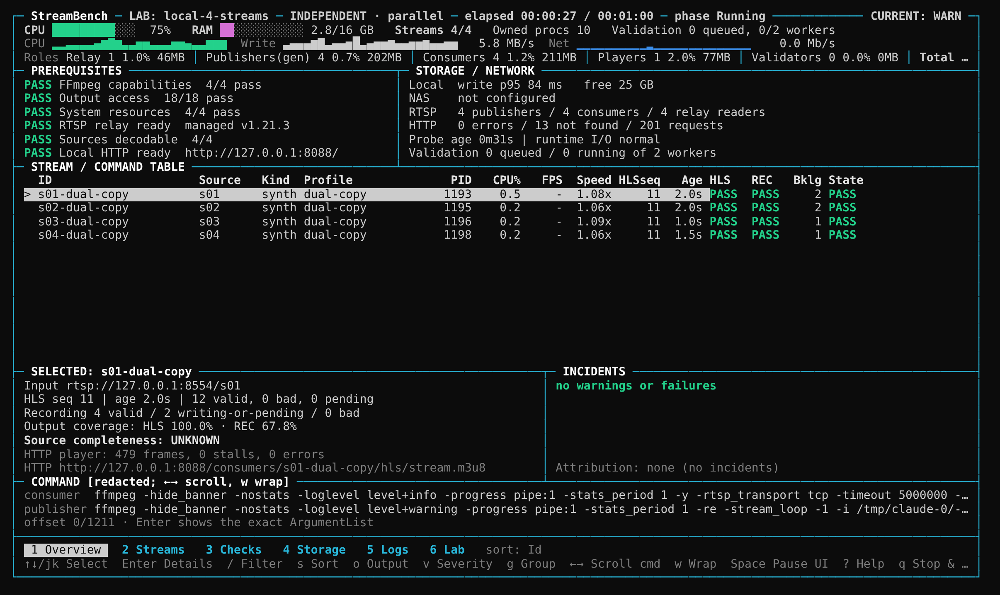
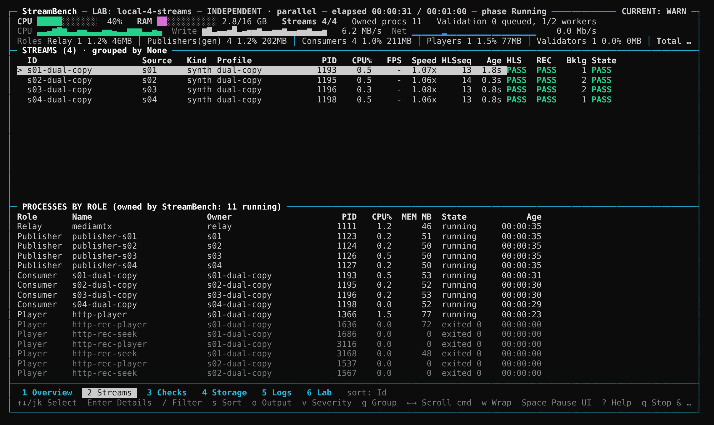
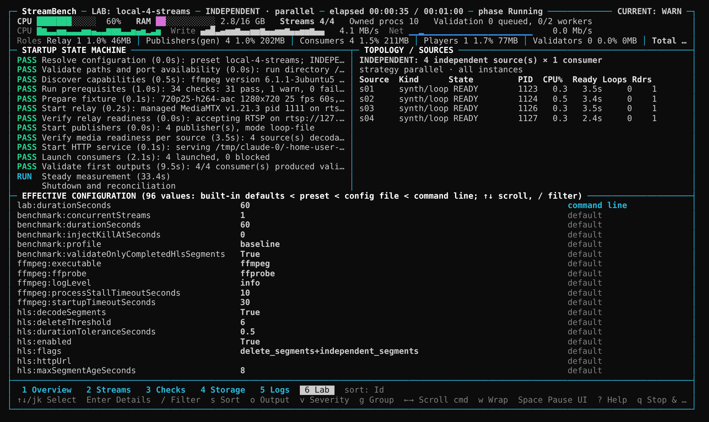
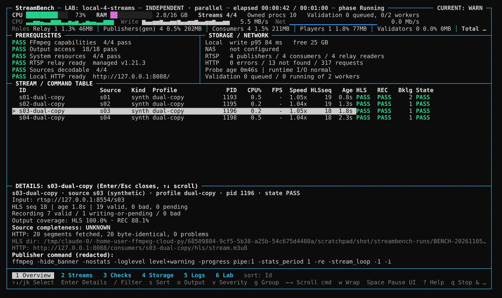

# StreamBench: FFmpeg Stream & Recording Reliability Benchmark

[](https://github.com/hanokhaloni/ffmpeg-cloud-py/actions/workflows/ci.yml)

StreamBench is a full-screen, bashtop-style tool (C#, .NET 8) that tests FFmpeg **RTSP → HLS + MP4 recording** pipelines end to end. It targets Windows Server and also runs on Linux.

An FFmpeg exit code of 0, a growing file or an updated playlist does not prove that recording works. StreamBench independently verifies three things:

| Stage | Question | How |
|---|---|---|
| **Ingestion** | Is FFmpeg processing the stream in real time? | `-progress` watchdog (media time, speed), classified FFmpeg log lines |
| **Production** | Is every HLS segment and recording present, complete and valid? | every sequence number and file index is accounted for; every file is probed **and fully decoded**; unfinalized MP4s are detected |
| **Consumption** | Can another process actually use it? | HTTP delivery is checked byte for byte against the validated files; a live HTTP player runs in real time; sampled recordings are played over HTTP with seeks |

**Primary metric: verified media coverage** = decoded and accounted-for media ÷ expected media, reported per stream for HLS and recordings.

It has two operating modes:
- **`lab`**: a built-in multi-stream lab. StreamBench starts its own RTSP relay (MediaMTX), N publishers and M benchmark consumers, serves the outputs over HTTP, validates everything, and cleans up only what it started.
- **`run`**: the same pipeline against real cameras or other external RTSP sources.



<details><summary>More views: Streams (processes by role), Lab (startup state machine, effective configuration), stream details</summary>





</details>

*(Captured from a real `StreamBench lab --duration 60` run in a 140×42 terminal.)*

The design and the mandatory requirements are in [docs/DESIGN.md](docs/DESIGN.md).

---

## 1. Quick start

You need:
- [.NET 8 SDK](https://dotnet.microsoft.com/download/dotnet/8.0), or the published `StreamBench.exe` (section 2.1)
- `ffmpeg` and `ffprobe` on `PATH` (or `--ffmpeg` / `--ffprobe`)
- [MediaMTX](https://github.com/bluenviron/mediamtx/releases) as `tools/mediamtx/mediamtx(.exe)`, on `PATH`, or via `--relay-exe` (lab mode only)

```bash
git clone https://github.com/hanokhaloni/ffmpeg-cloud-py
```
```bash
cd ffmpeg-cloud-py
```
```bash
dotnet run -c Release --project src/FFmpegReliabilityBench.App -- lab
```

That is the **zero-edit default lab**. With no JSON edits it:
1. discovers dependencies and shows the prerequisites
2. prepares a deterministic fixture (1280×720, 25 fps, H.264, AAC 48 kHz stereo, keyframe every second), once
3. starts a managed MediaMTX relay on `127.0.0.1:8554`
4. starts **4 publishers** (`ffmpeg -re -stream_loop -1 -i fixture.mp4 -c copy -f rtsp …/s01…s04`)
5. waits until each path yields **decoded frames**
6. starts a loopback HTTP server on `127.0.0.1:8088`
7. launches **4 benchmark consumers** (`dual-copy`: HLS 2 s + MP4 5 s, stream copy), 500 ms apart
8. validates every HLS segment and recording (probe + full decode + seeks), checks HTTP delivery, and plays one live stream plus sampled recordings
9. shows the full-screen dashboard for **10 minutes**
10. stops everything in order and writes the report

If something is missing, StreamBench prints the exact missing path and exits with code 3. It never downloads or installs anything.

Expected result on a healthy machine: 100 % HLS and recording coverage on every stream, runtime **PASS**, and overall **WARN** (checks that cannot be verified, such as disk health, are UNKNOWN, and UNKNOWN is never counted as PASS).

For CI, services or log files, add `--no-tui` (this is automatic when output is redirected). You get the same evidence and the same verdicts, printed as plain lines.

---

## 2. Guide: Windows Server

### 2.1 Install

1. Publish a self-contained distribution (on any machine with the .NET 8 SDK and PowerShell):

   ```bash
   pwsh ./scripts/Publish-StreamBench.ps1 -MediaMtx C:\Downloads\mediamtx_v1.21.3_windows_amd64\mediamtx.exe
   ```

   This creates `dist\`:

   ```text
   dist\Start-StreamBenchLab.ps1
   dist\app\StreamBench.exe              (+ .NET runtime; nothing to install on the server)
   dist\config\*.json   dist\profiles\*.json
   dist\tools\mediamtx\mediamtx.exe      (only if -MediaMtx was given)
   ```

2. Copy `dist\` to the server, e.g. to `C:\StreamBench`.
3. Put the **same FFmpeg build as production** (for example Gyan 4.4) on `PATH`, or pass `--ffmpeg C:\FFmpeg\bin\ffmpeg.exe --ffprobe C:\FFmpeg\bin\ffprobe.exe`.

### 2.2 First lab run

```bash
cd C:\StreamBench
```
```bash
.\Start-StreamBenchLab.ps1
```

The launcher is deliberately thin. It finds `app\StreamBench.exe`, forwards **only the options you pass**, and returns the application's exit code (0 PASS, 1 WARN, 2 FAIL, 3 could not run). StreamBench itself starts and stops the relay, publishers and consumers.

```bash
.\Start-StreamBenchLab.ps1 -Streams 8 -Duration "00:30:00"
```
```bash
.\Start-StreamBenchLab.ps1 -Config .\config\nas-lab.json
```
```bash
.\Start-StreamBenchLab.ps1 -Profile original,dual-copy -Execution sequential
```
```bash
.\Start-StreamBenchLab.ps1 -Headless --relay external --relay-url rtsp://127.0.0.1:8554
```

### 2.3 Using the dashboard

| Key | Action |
|---|---|
| `1`–`6`, `Tab` | views: **Overview**, **Streams** (streams + processes by role), **Checks**, **Storage**, **Logs**, **Lab** (startup state machine, sources, effective configuration and where each value came from) |
| `↑` `↓` / `j` `k`, `PgUp` `PgDn` `Home` `End` | select a stream / scroll a list |
| `Enter` | details of the selected stream: input, publisher and consumer commands (redacted), the exact `ArgumentList`, outputs, coverage, attribution, evidence |
| `/` | filter by text (`Enter` applies, `Esc` clears) |
| `s` / `r` | sort by ID, CPU, state, latency or validation backlog / reverse |
| `o` / `v` / `g` | output filter (HLS or REC issues) / incident severity / group by source or profile |
| `←` `→` / `h` `l`, `w` | scroll / wrap the command line |
| `Space` | pause the **display**; recording, monitoring and validation continue |
| `?` | help |
| `q` | stop & exit (asks for confirmation); `Ctrl+C` stops gracefully at once, a second `Ctrl+C` aborts |

The layout is designed for **140×42**. It switches to a compact layout at about 100×30 (the selected stream's detail replaces the lower panels) and a minimal view below that. Resizing is handled live. Use `--ascii` for consoles without Unicode, `--no-color` (or `NO_COLOR`) for monochrome, and `--no-tui` for headless runs. Child processes never write to the terminal; their logs are files in the run directory.

**Reading the table:** HLS and REC show `PASS`, `WAIT` (starting), `LATE` (playlist or recording overdue), `BKLG` (validation backlog) or `FAIL`. State shows `START`, `PASS`, `WARN`, `FAIL`, `STALL`, `BLOCK` (source never became ready) or `STOP`. The header shows the **CURRENT** verdict while running and the **FINAL** verdict at the end.

### 2.4 Lab variations

| Question | Command |
|---|---|
| More cameras | `lab --streams 8` |
| Many readers of the same source | `lab --streams 1 --consumers-per-stream 4`: labelled **FAN-OUT**, never "4 cameras" |
| Capacity / contention | `lab --streams 4 --consumers-per-stream 3` (MIXED) |
| Generator cost | `lab --publisher-mode live-synthetic`: publishers encode live; their CPU is reported separately under the Publisher role |
| Compare commands | `lab --profiles original,dual-copy,dual-transcode`: runs **sequential** groups by default, so configurations never compete |
| Run commands side by side on purpose | `lab --profiles original,dual-copy --execution parallel` |
| Find the breaking point | `lab --preset staged-8` or `lab --streams 8 --execution staged-load --stages 1,2,4,8` |
| FFmpeg 4.4 vs 7 | define `"executables": { "ffmpeg-7": "C:\\FFmpeg7\\bin\\ffmpeg.exe" }` and a template with `"executableReference": "ffmpeg-7"`; compare with `--execution sequential` |
| NAS storage | `lab --config config\nas-lab.json` (run directory on `\\NAS01\…`) |
| Existing relay | `lab --relay external --relay-url rtsp://10.0.0.5:8554` (StreamBench never stops it) |
| Publisher crash | `lab --kill-publisher s02@120`: only s02's consumers fail, and their failures are attributed upstream |
| Consumer crash | `lab --kill-consumer s01-dual-copy@120` |
| Show what would run | `print-commands [same options]`: every publisher and consumer command, redacted, nothing started |

Presets (`--preset`): `local-4-streams` (default), `fan-out-4`, `mixed-4x3`, `live-synthetic-4`, `profile-compare`, `staged-8`, `cameras`. Run `StreamBench presets` for the list with descriptions.

### 2.5 Real cameras

```bash
StreamBench.exe run --config config\camera-group.json
```
```bash
StreamBench.exe run --source rtsp://192.168.1.10:554/axis-media/media.amp --duration 01:00:00
```

A configuration can mix cameras and synthetic sources. The dashboard shows the kind of every source (`cam` / `synth`). Camera credentials never go in config files. Store them in Windows Credential Manager **as the account that runs StreamBench**, or set `FRB_RTSP_USER` / `FRB_RTSP_PASSWORD`:

```bash
cmdkey /generic:FFmpegReliabilityBench:192.168.1.10 /user:viewer /pass:secret
```

Run StreamBench as the **same account as the production FFmpeg service**; filesystem, SMB and antivirus behaviour depend on it:

```bash
runas /user:DOMAIN\svc-video "C:\StreamBench\app\StreamBench.exe run --config C:\StreamBench\config\camera-group.json"
```

For the camera clock (±500 ms), add `"time": { "enabled": true, "ntpServer": "<your NTP>" }` and an ONVIF URL. ONVIF reports whole seconds, so on its own it can show WARN but never prove PASS. Without independent evidence, the camera clock is UNKNOWN.

### 2.6 Reading the results

When a run ends, the dashboard shows the FINAL verdict and the summary is printed. Everything is in `streambench-runs\<session>\`:

```text
report\report.html     summary, lab topology and startup state machine, per-role load, effective configuration, timelines, events, hypotheses
report\report.json     everything, machine-readable
report\results.csv  events.csv  <instance>.hls-segments.csv  <instance>.recording-timeline.csv  ffmpeg-capabilities.txt
logs\                  relay-mediamtx.log, mediamtx.yml, publisher-sNN.log, <instance>.ffmpeg.log (complete original FFmpeg logs), player logs
consumers\<instance>\  hls\  rec\  segments.csv    (isolated outputs per consumer, kept for inspection)
```

- Statuses are never averaged: any **FAIL** fails the run, WARN and UNKNOWN degrade it, and UNKNOWN is never PASS. Prerequisites and runtime are reported separately.
- **Coverage** below 100 % names the missing, corrupt or unverified segments and recordings.
- **Attribution:** a consumer's failures caused by a dead publisher or relay are prefixed `[upstream: publisher s02 …]`. Correlations are labelled **HYPOTHESIS** (they show co-occurrence, not proof). Incidents at a fixture loop boundary are labelled **EXPLAINED (expected)**.
- **Lab results:** LAB-001 topology and strategy, LAB-002 relay, LAB-003 per-source media readiness, LAB-004 publisher stability, LAB-005 HTTP service, LAB-006 load by role (generator vs consumers), LAB-007 startup, LAB-008 recording playback over HTTP, LAB-009 cleanup of owned processes.

### 2.7 Single-pipeline mode and diagnostics

`StreamBench bench` runs one FFmpeg command (or N copies of it) directly against a source and the **real production directories**, including the full storage diagnostics. It is useful for checking `H:\hls` / `Y:\recording` or a NAS share under the service account:

```bash
StreamBench.exe preflight --config config\windows-local-ntfs.json
```
```bash
StreamBench.exe bench --config config\windows-local-ntfs.json --duration 3600
```
```bash
StreamBench.exe bench --config config\windows-local-ntfs.json --config config\smb-storage.json --profile tee --kill-at 120
```

`bench` options: `--source`, `--transport tcp|udp`, `--profile baseline|copy|fmp4|tee`, `--recording-mode mp4|faststart|fmp4`, `--streams N`, `--duration S`, `--kill-at S`, `--hls-dir`, `--rec-dir`, `--http-url`, `--ntp`, `--onvif`, `--ffmpeg`, `--ffprobe`, `--print-command`, `--preflight-only`, `--filesystem-only`, `--hls-only`, `--recording-only`, `--no-tui`. Media goes to per-session subfolders, so production files are never touched.

---

## 3. Reference

### 3.1 Commands

```text
StreamBench lab [options]            built-in multi-stream lab (defaults: 4 publishers × 1 consumer, dual-copy, 10 min)
StreamBench run [options]            cameras / external sources (preset 'cameras': no relay, no publishers)
StreamBench print-commands [options] all publisher/consumer commands the lab would launch, redacted; nothing is started
StreamBench presets                  presets, command templates, placeholders, fixture presets
StreamBench bench | preflight [...]  single-pipeline mode (2.7)
StreamBench report latest            non-PASS results of the latest report
```

`lab` / `run` options: `--preset` · `--config FILE` (repeatable) · `--streams N` · `--consumers-per-stream K` · `--duration 00:10:00|600|10m` · `--profiles a,b` · `--execution parallel|sequential|staged-load` · `--stages 1,2,4` · `--stagger MS` · `--group-duration S` · `--stage-duration S` · `--publisher-mode loop-file|live-synthetic` · `--fixture 720p25-h264-aac|1080p25-h264-aac|360p25-h264-aac` · `--source URL` (repeatable) · `--relay managed|external|none` · `--relay-exe PATH` · `--relay-url URL` · `--rtsp-port N` · `--http-port N` · `--no-http` · `--no-player` · `--sample-every N` · `--run-root DIR` · `--workers N` · `--fail-fast` · `--kill-publisher ID@S` · `--kill-consumer ID@S` · `--ffmpeg` · `--ffprobe` · `--no-tui` · `--no-color` · `--ascii` · `--refresh-hz` · `--history-seconds`

**Precedence:** built-in defaults < preset < config file(s) < command line. The Lab view and the report show every effective value and its origin.

Exit codes: `0` PASS · `1` WARN · `2` FAIL · `3` could not run (missing dependency, busy port, invalid configuration).

### 3.2 Command templates

Commands are **argument arrays**, never shell strings:

```json
{
  "lab": {
    "consumers": { "profiles": [ "my-copy" ] },
    "templates": [
      {
        "id": "my-copy",
        "executableReference": "ffmpeg-current",
        "arguments": [
          "-rtsp_transport", "tcp", "-i", "{inputUrl}",
          "-map", "0:v:0", "-map", "0:a:0?", "-c", "copy",
          "-f", "hls", "-hls_time", "2", "-hls_list_size", "6",
          "-hls_segment_filename", "{hlsDir}/seg_%06d.ts", "{hlsDir}/stream.m3u8",
          "-map", "0:v:0", "-map", "0:a:0?", "-c", "copy",
          "-f", "segment", "-segment_time", "5", "-reset_timestamps", "1",
          "-segment_list", "{segmentListPath}", "-segment_list_type", "csv",
          "{recordingDir}/rec_%06d.mp4"
        ]
      }
    ]
  }
}
```

- Placeholders: `{inputUrl} {streamId} {profileId} {instanceId} {runDir} {hlsDir} {recordingDir} {segmentListPath}`. Use `{{` and `}}` for literal braces.
- Rejected before launch: unknown placeholders, shells, and output paths shared between instances.
- Applied to every consumer: `-progress pipe:1`, `-stats_period 1` (when supported), level-tagged logs, `-stimeout` (FFmpeg 4.x) or `-timeout` (5+) for RTSP, and `temp_file` removed when unsupported.
- Built-in templates: `dual-copy` (default), `dual-transcode`, `original` (the production command shape: `-re`, `split=2`/`asplit=2`, two libx264/AAC encodes), `hls-copy`, `rec-copy`, `rec-fmp4-copy`. Aliases: `controlled-copy`, `controlled-transcode`, `original-command`.

### 3.3 Configuration

`config/default.json` lists every key with its default. The most important ones:

| Key | Default | Meaning |
|---|---|---|
| `lab.durationSeconds` | 600 | measurement duration (sequential/staged runs split it per group/stage unless `groupDurationSeconds`/`stageDurationSeconds` are set) |
| `lab.publishers.count` / `.mode` / `.fixturePreset` | 4 / loop-file / 720p25-h264-aac | synthetic sources |
| `lab.consumers.instancesPerSource` / `.profiles` / `.execution` / `.staggerMilliseconds` | 1 / [dual-copy] / parallel / 500 | benchmark consumers |
| `lab.relay.mode` / `.executable` / `.rtspPort` / `.rtpPort`,`.rtcpPort` / `.apiPort` | managed / `.\tools\mediamtx\mediamtx.exe` / 8554 / 8000,8001 (RTP even, RTCP = RTP+1) / 9997 | RTSP relay |
| `lab.http.listenAddress` / `.port` | 127.0.0.1 / 8088 | loopback HTTP server |
| `lab.validation.maxDecodeWorkers` / `.recordingHttpSampleEvery` / `.livePlayer` | auto (cores/2, ≥2) / 3 / true | bounded validation, HTTP playback sampling |
| `lab.sources[]` | (empty) | `{ "id", "kind": "camera" \| "synthetic", "url", "mode" }` |
| `lab.faults[]` | (empty) | `{ "type": "kill-publisher" \| "kill-consumer", "target", "atSeconds" }` |
| `lab.failFast` | false | stop everything at the first mandatory failure |
| `ui.mode` / `.refreshHz` / `.historySeconds` / `.asciiFallback` / `.color` | full-screen / 4 / 300 / auto / true | dashboard |
| `executables` | `{ "ffmpeg-current": "ffmpeg" }` | named FFmpeg builds for templates |
| `ffmpeg.*`, `storage.*`, `hls.*`, `recording.*`, `time.*`, `benchmark.*` | | single-pipeline mode and validation thresholds |

### 3.4 Test catalogue

| Area | IDs |
|---|---|
| System | SYS-001…015: OS, architecture, CPU, RAM, disk space, path type (mapped drives under a service fail), FFmpeg/FFprobe + SHA-256, encoders, muxers + feature support, concurrent FFmpeg, Defender (diagnose only), identity |
| Filesystem | FS-001…018: create/write/durable flush/read/SHA-256/rename/delete, concurrency, latency p50/p95/p99, segment writes, sharing semantics |
| Network / time | NET-001…012 (DNS, TCP, RTSP OPTIONS/DESCRIBE, stream open, retransmissions, NIC errors); TIME-001…003 (SNTP, ONVIF camera clock, w32tm); TS-001 PTS/DTS continuity |
| Process | PROC-001 lifetime, 002 forward progress, 003 classified log errors, 004 real-time speed, 005 resources |
| HLS | HLS-001 RFC 8216 validity, 002 advancement, 003 every segment accounted for, 004 probe + decode, 005 durations, 006 coverage, 007 local consumer, 008 HTTP delivery (byte-identical to validated files), 009 live HTTP player |
| Recording | REC-001 cadence, 002 missing intervals, 003 lifecycle (finalized, probe, decode), 004 durations, 005 seeks, 006 coverage, 007 locks after close, 008 playback over HTTP (sampled) |
| Lab | LAB-001…009 (2.6) |
| Resources | RES-001 CPU, 002 memory, 003 StreamBench's own memory; SCALE-001 concurrent streams |
| Fault injection | FI-001 forced termination (bench), `--kill-publisher` / `--kill-consumer` (lab) |

---

## 4. Development

```bash
dotnet build
```
```bash
dotnet test
```

The test suite covers parsers, playlist and timestamp analysis, coverage and health rules, templates and placeholder validation, configuration precedence and origins, schedules, topology labels, port checks, role accounting, and the renderer at 140×42, 100×30 and minimal sizes (including ASCII, no-color, every view and overlay, filters and the key state machine). It also includes acceptance tests that start real MediaMTX and FFmpeg processes on free ports: the default 4×1 lab, publisher-failure isolation, busy ports, sequential fan-out, generator load, pause/resize/log flood during a live run, headless vs dashboard parity, and a real Ctrl+C. Tests that need `ffmpeg`, `ffprobe` or `mediamtx` pass trivially when those tools are missing.

CI (`.github/workflows/ci.yml`) builds and tests on **Ubuntu and Windows** (Windows uses the Gyan FFmpeg build), with MediaMTX downloaded into `tools/mediamtx`. It then runs a short headless lab and uploads the reports.

```text
src/FFmpegReliabilityBench.Core
  Lab/          LabOrchestrator (state machine, strategies, cleanup), LabRuntime, RelayManager (MediaMTX), LabHttpServer (Kestrel),
                CommandTemplates, Fixture, ProcessRegistry (roles), Ports, LabEvaluator
  Runner/       FFmpegRunner, ProcessUtil, ProgressParser, FFmpegLogParser, FFprobeRunner (bounded workers), CommandBuilder, Capabilities
  Validation/   HlsPlaylist, HlsMonitor, RecordingMonitor, PlaybackConsumer, HttpHlsConsumer, Coverage, TimestampAnalyzer
  Diagnostics/  Preflight, Filesystem, Network, Time, ResourceMonitor, RestartManager, Correlation, SystemInfo
  Engine/       Orchestrator (bench), Evaluator, BenchState      Config/  BenchConfig, LabConfig, ConfigLoader (presets, origins)
  Reporting/    JSON / CSV / HTML
src/FFmpegReliabilityBench.App (StreamBench)
  Tui/          DashboardStateProvider → immutable DashboardSnapshot → Renderer (pure) → TerminalPresenter; TuiController (UI thread, keys, overlays)
  Program.cs, LabCli.cs, Cli.cs, Headless.cs, Summary.cs
scripts/        Start-StreamBenchLab.ps1, Publish-StreamBench.ps1
config/ profiles/ docs/DESIGN.md
```

## 5. Limitations

- Source completeness (ground-truth verification of what the source sent) is not implemented and is always **UNKNOWN**. Output coverage is not source completeness.
- The player is FFmpeg-based. No real browser engine is embedded.
- CPU of very short-lived validation workers is sampled at 1 Hz, so it is a lower bound.
- The camera clock uses ONVIF only (1 s resolution). RTCP Sender Reports and overlay OCR are not implemented.
- `bench` fault injection covers forced termination only; the lab adds publisher and consumer kills.
- The Windows-specific code paths run in CI on `windows-latest`, not on Windows Server itself.
